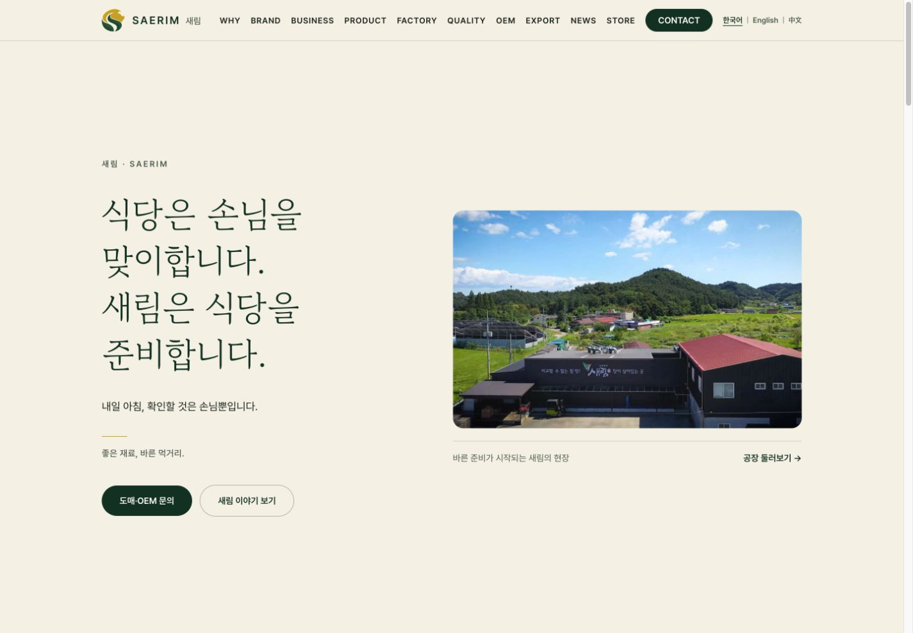
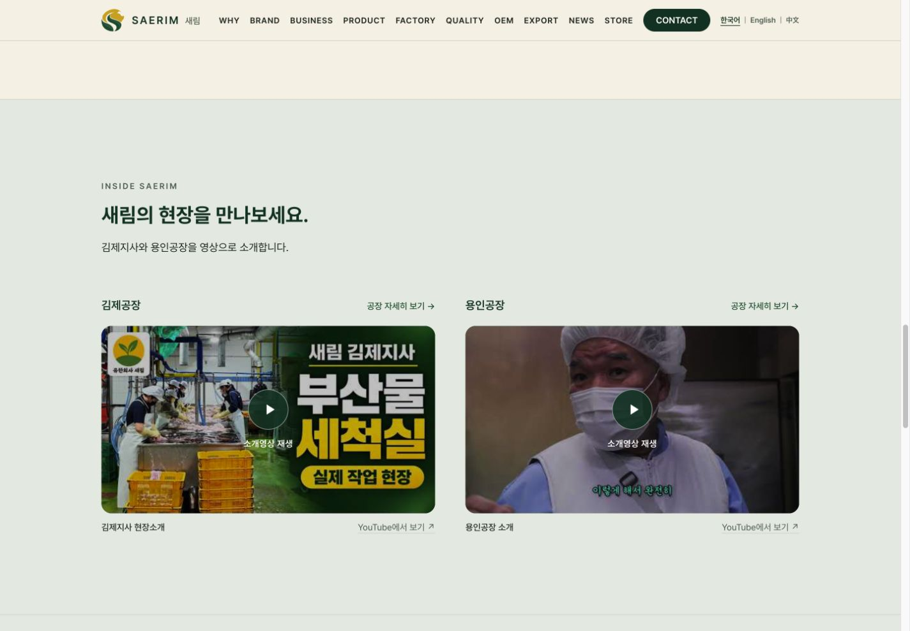
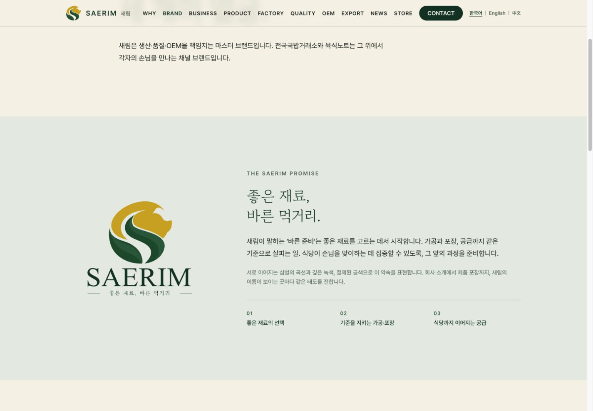

# 공장 전경·브랜드 소개·지사 영상 QA — 2026-10-24

로컬 프로덕션 빌드와 `http://localhost:3100`에서 확인했다. 기존 [브랜드 QA](../brand-identity-2026/README.md)의 홈 Hero·공장 사진 배치 캡처는 이 문서의 최종 화면으로 대체한다.

## 변경 결과

- HOME: 회사 전경을 첫 화면으로 옮기고 브랜드 메시지·문의 버튼과 나란히 배치. 하단 중복 사진 제거.
- BRAND: 원본 로고(256px)와 ‘좋은 재료, 바른 먹거리’, ‘바른 준비’ 설명 추가.
- HOME·FACTORY 목록: 김제·용인 두 영상. 상세 페이지: 해당 공장 영상 한 개. 군산은 기존 사진 유지.
- 한국어·영어·중국어 제목과 재생 UI. 원본 영상 언어는 그대로 유지.

## 검증

| 항목 | 결과 |
|---|---|
| ESLint `--max-warnings=0` | 통과 |
| TypeScript `--noEmit --incremental false` | 통과 |
| Next 프로덕션 build | 통과 (기존 middleware·Browserslist 안내만 출력) |
| 기존 SEO 검사 | 9경로·96 sitemap URL·robots·리다이렉트·404 통과 |
| 320 / 390 / 1024 / 1440px | 홈 3개 언어·BRAND·공장 목록·김제/용인 상세에서 가로 넘침 없음 (`scrollWidth <= clientWidth`) |
| 지사별 영상 매핑 | 김제 `4pXO82VN6bQ`, 용인 `Y2fNzjaCV54` |
| 실제 재생 | 홈페이지에서 두 영상의 재생 진행 및 플레이어 제목 확인. 용인 상세 모바일 재생도 확인 |
| 초기 로딩 | 모든 검사 페이지에서 클릭 전 iframe 0개 |
| 키보드 | Enter로 영상 로드, iframe으로 포커스 이동 |
| 모바일 플레이어 | 390px 화면에서 327×200px, 가로 넘침 없음 |
| 다국어 | en/zh 공장 목록·두 상세·BRAND의 언어·제목·영상 URL 확인 |
| 링크 | 공장 목록 김제 링크→`/factory/gimje` 실제 이동 확인. YouTube 직접 보기 링크 제공 |
| 브라우저 오류 | 최종 홈 검사에서 console error 없음 |

모바일 검증 중 발견한 영상 카드의 자동 최소 너비와 320px 헤더 넘침을 수정했다. 영상은 사용자 클릭 이후 `youtube-nocookie.com`에서 로드하며 `strict-origin-when-cross-origin` referrer 정책을 명시한다.

동영상 제목·채널은 YouTube 공식 oEmbed로 확인했다. 테스트 시 재생 가능했으며, 향후 업로더의 공개·임베드 설정 변경은 외부 서비스에 따른다. DB·제품 데이터·원본 AI/PDF는 변경하지 않았다. 로컬 DB의 창립연도 2003 표시는 기존 데이터다.

## 캡처와 기록

- 01 홈 전경 데스크톱 / 04 모바일 / 07 영어 모바일
- 02 홈 영상 실제 재생 / 10 홈 영상 초기 커버 / 05 모바일
- 03 브랜드 약속과 원본 로고
- 06 용인 상세 모바일 재생 / 08 공장 목록 / 09 김제 상세
- `responsive-checks.json`, `locale-checks.json`, `player-checks.json`

